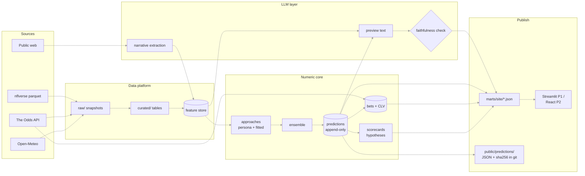
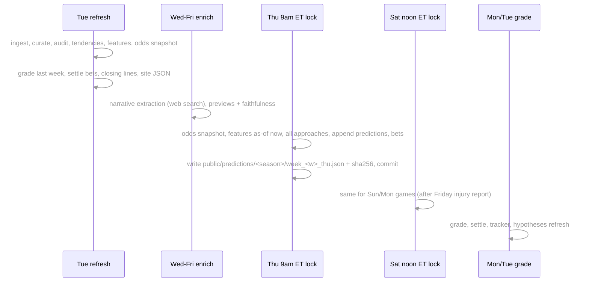

# Architecture

Planned 2026-10-26 after the local POC. Scope and goals: [PROJECT_BRIEF.md](PROJECT_BRIEF.md). Decisions and their reasons: [adr/](adr/). Work breakdown: [tasks.md](tasks.md). This file says what the system *is*; it does not repeat why.

## 1. Overview

A weekly NFL preview tool that is educational first and market-aware second. Every game is predicted by several **approaches**: personas (the Traditionalist, the Analyst, the Sharp, later the Matchup and the Narrative) that weigh the *same* shared features differently, the way different kinds of fans do. Each approach has two flavors: **persona** weights (hand-reviewed, the character) and **fitted** weights (regression shrunk toward the persona, walk-forward on history). An **ensemble** averages the fitted flavors. Every approach is scored publicly against the market and a naive baseline on forecast quality, on odds-weighted paper bets, and on how often it was right when it disagreed with the market. A **Hypotheses** page shows what history says about each feature. An LLM extracts the week's narrative into structured, cited features (live only) and writes previews whose numbers are checked against the data.

Principles (from the brief, unchanged): the LLM stays out of the numeric core; point-in-time correctness everywhere; ship live early; be honest about limits.

## 2. Components



| Component | Module(s) | Responsibility |
|---|---|---|
| Ingest | `nfl/ingest.py`, `nfl/odds.py`, `nfl/weather.py` | Download upstream bytes into immutable snapshots with manifests. nflverse by URL; Odds API JSON; Open-Meteo JSON. |
| Curate | `nfl/curate.py` | DuckDB builds `games`, `plays` (pbp ⋈ FTN), `injuries`, `depth_charts`, `lines`, `weather` from the latest snapshots. Deterministic. |
| Audit | `nfl/audit.py` | Null rates per column per season; freshness per dataset. |
| Tendencies | `nfl/tendencies.py` | Team × situation × metric rates with shrinkage and recency decay. Feeds features and the game page. |
| Feature store | `nfl/features/` | One long as-of table of every input any approach uses. Builders per family. |
| Approaches | `nfl/approaches/` | YAML configs, scoring engine, walk-forward fitting, calibration, ensemble, per-feature contributions. |
| Reference models | `nfl/models/` | `market`, `elo`, `naive` stay as scorecard reference lines and as feature sources. |
| Lock | `nfl/lock.py` | Live prediction run at a lock point; writes prediction rows and the public JSON + hash. |
| Grade and ledger | `nfl/grade.py`, `nfl/ledger.py` | Scores predictions, settles paper bets, computes CLV and divergence buckets. |
| Hypotheses | `nfl/hypotheses.py` | Per-feature coefficients, CIs, verdicts from the global fit. |
| LLM | `nfl/llm/` | Narrative extraction, preview text, faithfulness check, call log. Separate entrypoints, versioned prompts. |
| Site | `nfl/site.py` | Writes the JSON contract the UI reads. |
| UI | `nfl/ui/app.py` (P1), `web/` (P2) | Streamlit explorer, then React + TS static site. |
| CLI | `nfl/cli.py` | Every job is a subcommand; the container runs the same commands everywhere. |

## 3. Data model

### 3.1 Storage layers (unchanged from the POC)

One data root, `NFL_DATA_ROOT`, always a filesystem path (local `./data`, GCS via Cloud Storage FUSE in P2).

```
raw/<source>/<dataset>/snapshot_ts=<ts>/ + manifest.json   immutable upstream bytes
curated/<table>/season=YYYY/                                rebuildable from raw
marts/                                                      features, fits, predictions, bets, scorecards, llm_calls, site/
```

Git holds code, prompts, approach configs, `public/predictions/` lock artifacts, and `docs/`. Never parquet.

### 3.2 Curated tables

| Table | Grain | Key columns |
|---|---|---|
| `games` | game | `game_id, season, week, game_type, kickoff_utc, home_team, away_team, location, roof, surface, spread_line, total_line, home_moneyline, away_moneyline, home_rest, away_rest, div_game, result, home_score, away_score, home_coach, away_coach, home_qb_name, away_qb_name` |
| `plays` | play | POC 37-column pbp subset + FTN flags, `has_ftn` |
| `injuries`, `depth_charts` | report row | as POC |
| `lines` (new) | game × book × market × snapshot | `game_id, snapshot_ts, book, market ('h2h','spreads','totals'), side, price_american, point` |
| `weather` (new) | game | `game_id, fetched_at, temp_c, wind_kph, precip_mm, is_forecast` |
| `stadiums` (new, from CSV in repo) | stadium | `stadium, team, lat, lon, tz, altitude_m, roof` incl. international venues |

### 3.3 Feature store

`marts/features/season=YYYY/*.parquet`, long format:

| column | type | meaning |
|---|---|---|
| `season, week, game_id` | | target game |
| `side` | `home` / `away` / `game` | team-level value, or a game-level value |
| `feature` | str | `<family>.<name>`, e.g. `environment.rest_days`, `market.p_home_vigfree` |
| `value` | float | null allowed |
| `known_as_of` | timestamp | backtest (game kicked off before the build): synthetic `kickoff − 2h`, strictly before the `kickoff − 1h` synthetic lock; upcoming games: the build time |
| `source` | str | `pbp`, `schedules`, `ftn`, `odds_api`, `open_meteo`, `llm_narrative`, `elo`, `tendencies` |
| `version` | str | builder version; narrative features carry the prompt version |

Storage: `marts/features/season=YYYY/<family>.parquet`, written by `nfl.features.store.write_features` as an upsert on `(game_id, side, feature, known_as_of)`; a later row repeating the latest stored value is skipped. **Builder contract:** each `nfl/features/<family>.py` exposes `SOURCE`, `VERSION` and `build(paths, games, build_ts) -> DataFrame` of store rows, made with `store.from_team_values` / `store.from_game_values` (which apply the stamping rule). Builders never write; `nfl features` (M1.9) does. Season-to-date values for a game use only games that kicked off strictly before it.

The engine turns rows into one **game vector** per game: for `team` features `home − away`, for `game` features the value. Vectors are standardized with the scaler saved in the fit (mean/sd over the training window); missing values become 0 after standardization (league average). This is what lets FTN-era features coexist with 2010+ features.

Families and first features (builders in `nfl/features/<family>.py`):

| Family | Features (side) | Source |
|---|---|---|
| `strength` | `elo_pre` (team), `epa_off`, `epa_def`, `success_off`, `success_def`, `point_diff_pg` (team, season-to-date, shrunk toward prior season / league) | elo, pbp |
| `environment` | `rest_days`, `travel_km`, `tz_shift` (team); `is_dome`, `is_turf`, `div_game`, `primetime`, `neutral_site`, `temp_c`, `wind_kph` (game) | schedules, stadiums, weather |
| `form` | `last3_win_pct`, `last3_margin`, `streak` (team) | games |
| `decisions` | `fourth_go_rate_oe`, `pass_rate_oe`, `early_down_pass_rate`, `explosive_rate`, `turnover_margin_pg` (team) | pbp (`xpass`/`pass_oe` precomputed), tendencies |
| `front` | `blitz_rate`, `box_8plus_rate`, `motion_rate`, `play_action_rate` (team; 2022+) | ftn via tendencies |
| `market` | `p_home_vigfree`, `spread_line`, `total_line`, `line_move_pts` (game) | schedules (backtest), odds_api (live) |
| `narrative` | `injury_impact` (0–3), `sentiment` (−1..1), `upset_buzz` (0–1), `qb_status` (0–2), `revenge`, `lookahead` (team; live only) | llm_narrative |

### 3.4 Approaches and fits

Config: `src/nfl/approaches/configs/<id>.yaml`.

```yaml
id: traditionalist
name: The Traditionalist
blurb: Trusts rest, travel, weather, the run game and who's hot.
emphasis: [strength, environment, form]        # families with the heaviest weights; every family may appear
calibration: platt
weights:                                        # on standardized home-minus-away features
  strength.elo_pre:      {w: 1.0, why: "Still believes in the better team"}
  environment.rest_days: {w: 0.6, why: "Rest wins games"}
  form.last3_win_pct:    {w: 0.7, why: "Momentum is real to him"}
  decisions.pass_rate_oe: {w: 0.1, why: "Hears about it, doesn't buy it"}
fit:
  shrink_to_persona: true
  lambda_grid: [1, 10, 100, 1000, 10000]   # on the summed log loss; ~700 ≈ persona as strong as 3,000 games
  train_from: 2010
```

Scoring: `logit = b + Σ w_f · z_f`, `p_home = σ(logit)`, `spread_home = Φ⁻¹(p_home) · 13.5`, `total = market total` (totals are not modeled in 2026). Contributions `w_f · z_f` are stored per prediction for the UI.

**Groups (ADR 0012, M2.8).** Features belong to groups (`docs/feature-groups.md`); a group's composite is `c_g = Σ v_{g,f} z_f` with inner weights `v` taken from the walk-forward global fit and normalized to unit variance, shared by every approach. Personas and the DIY page weigh the ~10 composites; overrides of `v` are allowed and re-normalized. Flat `weights:` on features remain valid as one-feature groups.

**One public line per approach (ADR 0004 amendment, 2026-10-27):** `model_id = <approach>` is the persona lightly fitted and calibrated; `<approach>.fitted` is kept as a diagnostic. **The market's forecast is never an input (ADR 0013):** the Market group holds market *behavior* only, capped at 20% of a persona's budget.

Flavors as originally designed (`model_id = <approach>.<flavor>`; superseded by the amendment above):
- **persona**: weights from YAML; Platt calibration `σ(a·logit + b)` fitted walk-forward so the persona's *ranking* is the character's while its confidence is honest.
- **fitted**: L2-regularized logistic regression with the penalty `λ‖w − w_persona‖²` (shrinks toward the persona, not zero), `λ` chosen per approach on validation seasons.
- **global**: one unconstrained ridge fit on all features; not an approach, but the source for the Hypotheses page and a reference line.
- **ensemble**: mean of the fitted flavors' logits (equal weights in 2026).

Fit artifacts: `marts/fits/<model_id>/<trained_through>.json` with scaler, weights, calibration, λ, training window, git sha. Walk-forward: fit on seasons `< S`, score season `S`, for S in 2015–2025. 2022–2024 pick `λ`; 2025 is the holdout; 2026 is live.

### 3.5 Predictions, bets, scorecards

`marts/predictions.parquet` (append-only; POC schema plus): `model_id, model_version (git sha + config hash), lock_ts, slot ('backfill'|'thu'|'sat'), data_snapshot_ts, p_home, spread_home, total, sd_margin, contributions (json), is_backfill`.

`marts/bets.parquet` (append-only, immutable): `bet_id, model_id, game_id, lock_ts, market ('h2h'|'spreads'), side, price_american, point, model_p, market_p_vigfree, edge, stake_units (1.0), book, closing_price, closing_point, clv, result ('win'|'loss'|'push'|null), units_net`. A bet exists when `|model_p − market_p_vigfree| > 0.05` at lock.

`marts/graded.parquet`, `marts/scorecard.parquet` (per model × season × week + cumulative: n, log_loss, brier, spread_mae, ece, ats_pct, units, clv_avg), `marts/divergence.parquet` (per model × bucket of |model_p − market_p|: n, hit_rate, log_loss).

### 3.6 LLM artifacts

`marts/llm_calls.parquet`: `run_id, job, model, prompt_version, input_tokens, output_tokens, cache_read_tokens, cost_usd, latency_ms, ts, game_id`.
`marts/narrative/season=YYYY/`: structured extraction per game × team: the features above plus `claims` (list of `{claim, source_url, published_at, confidence}`), `summary`, `prompt_version`, `known_as_of`.
`marts/previews/`: per game text + the faithfulness report (`numbers_checked, numbers_matched, unmatched[]`). A preview with unmatched numbers is not published.

### 3.6a Narrative records

`marts/narrative/season=YYYY/week=WW/<game_id>_<ts>.json`, one per game per research run, validated by `nfl.llm.narrative.GameNarrative` (claims dated ≤ `known_as_of`, record stamped before kickoff, teams match). `producer` is `claude_code` (the `/nfl-narrative` skill, development) or `api` (the Sonnet job, production); the pipeline treats both identically. Features come from `nfl.features.narrative`, stamped with the record's `known_as_of`.

### 3.6b DIY approach matrix (planned, M5.8)

`marts/diy/matrix.parquet` and `site/diy_matrix.json`: per scored game, the standardized vector (scaler trained through season − 1), outcome, market p, spread and context flags. Scoring any weight vector is a matrix product plus walk-forward Platt calibration, so the build-your-own page needs no server: Streamlit in P1, TypeScript on the same JSON in P2.

### 3.7 Site JSON (the UI contract)

| File | Content |
|---|---|
| `site/meta.json` | data freshness per dataset, last lock, git sha, approach list with blurbs |
| `site/slate_<season>_<week>.json` | per game: kickoff, teams, market line, every model's `p_home`/`spread`, divergence flags, ensemble |
| `site/game_<game_id>.json` | everything the game page needs: per-approach contributions, tendency matchup rows, narrative claims + sentiment, preview text, injuries |
| `site/scorecard.json`, `site/tracker.json` | scorecard rows; per model cumulative units, CLV, calibration bins, divergence buckets, weekly series |
| `site/hypotheses.json` | per feature: coefficient, CI, n, verdict, sentence, approaches that lean on it |
| `site/audit.json` | null rates, freshness |

Streamlit reads these in P1; React reads the same files in P2. The contract is versioned with `schema_version` in `meta.json`.

## 4. Key flows

### 4.1 Weekly rhythm (in-season)



Until P2 these are commands Austin runs (`nfl weekly refresh`, `nfl lock --slot thu|sat`, `nfl weekly grade`). From P2 Cloud Scheduler triggers the same commands as Cloud Run Jobs.

### 4.2 Lock

`nfl lock --slot thu|sat` (implemented in `src/nfl/lock.py`; slots by Eastern weekday: thu = Wed–Fri, sat = Sat–Tue; artifact name `week_<ww>_<slot>_<lock ts>.json`): refresh current-season data, take an odds snapshot; build features as-of now for the slot's games; load the frozen fits (trained through `S−1`); score every approach and flavor; append prediction rows with `lock_ts = now`; open bets where the edge exceeds the threshold; write the public JSON and its SHA-256; commit with message `lock: S W<W> <slot>`. Re-running a lock appends new rows; grading uses the last lock before kickoff.

### 4.3 Backtest and fit

`nfl fit`: build features for 2010–2025; for each approach run the walk-forward loop; pick λ; write fit artifacts; `nfl predict --backfill` writes one synthetic lock per historical game (`kickoff − 1h`, `is_backfill=true`) so the scorecard covers 2015–2025 under the same grading code as live rows. The leakage tests assert that every feature row used has `known_as_of < lock_ts` and every fit was trained on seasons before the scored season.

### 4.4 Grade and settle

Per (game, model): last lock before kickoff; log loss, Brier, spread error, ATS, calibration bin. Per bet: result from `games.result` against the line at lock; `clv` from the closing line: our latest Odds API snapshot within 3h before kickoff, else nflverse's schedule line (the Odds API historical endpoint is paid-only on the free plan; verified 2026-10-26). CLV is movement toward the bet (vig-free probability points for moneylines, points for spreads), null when bet and close are the same nflverse number. Divergence buckets: group graded rows by `|model_p − market_p|` in 0–2.5, 2.5–5, 5–10, 10+ points.

### 4.5 Narrative extraction (live only)

Per game, per team, Sonnet 5.5 with the built-in web search tool, output constrained to the narrative schema with citations. Prompt version frozen per week. Features land in the store with `known_as_of = run ts`, so a Thursday lock can only use Wednesday's extraction. Nothing from this flow is backfilled; the Narrative approach's record starts at its first live week and the UI says so.

## 5. Point-in-time rules

1. Backtest as-of is the game-week filter on the current nflverse snapshot, stamped `kickoff − 1h`. Historical data is not bitemporal; we don't pretend.
2. Live as-of is the ingestion snapshot timestamp. A lock may use only feature rows with `known_as_of < lock_ts`.
3. Fits used in season `S` are trained through `S−1` and frozen; refits during the season produce new `model_version`s and new rows, never edits.
4. Prediction and bet rows are append-only. Tests enforce 1–4.

## 6. Scoring

Primary: log loss, Brier, calibration (ECE + reliability bins), spread MAE, against `market_baseline` and `home_naive`. Secondary: ATS, odds-weighted units (flat 1 unit, 5-point threshold), CLV (primary *edge* metric), divergence buckets. Every scorecard states n and that ~180 live games cannot rank models; CIs are bootstrapped by season on the backtest.

## 7. Tech stack

Python 3.14 via uv; Polars + DuckDB (in-process, no DB server); numpy + scipy for fitting; pydantic + PyYAML for configs; Typer CLI; httpx; Anthropic Python SDK (structured outputs, web search tool, Batches API); Streamlit + Plotly (P1 UI); React + TypeScript + Vite (P2); Docker; Terraform; GitHub Actions (CI); GCP Cloud Run Jobs + Cloud Scheduler + GCS + Secret Manager + Workload Identity Federation; Firebase Hosting. pytest + ruff.

## 8. Deployment path

| Phase | Runs where | Data | UI |
|---|---|---|---|
| P0–P1 | Laptop, commands run by hand at lock times; CI on Actions | `./data` | Streamlit local |
| P2 | Cloud Run Jobs from one image, Cloud Scheduler, Terraform in `infra/` | GCS bucket via FUSE | React on Firebase Hosting |
| Self-hosting (separate project, after P2) | Desktop as primary runner, cloud as fallback | GCS stays source of truth | unchanged |

Portability rules: one image with CLI subcommands; config via env; data root is a path; no code knows where it runs.

## 9. Not in 2026

Matchup and Narrative approaches on the public scorecard (Narrative capture *does* run), Monte Carlo drive sim, totals modeling, player modeling, coordinator table and tendency discontinuities, participation-based coverage/personnel tendencies (data lands Feb 2027), Approach C (user predictions), API server, accounts, Langfuse, self-hosting.
