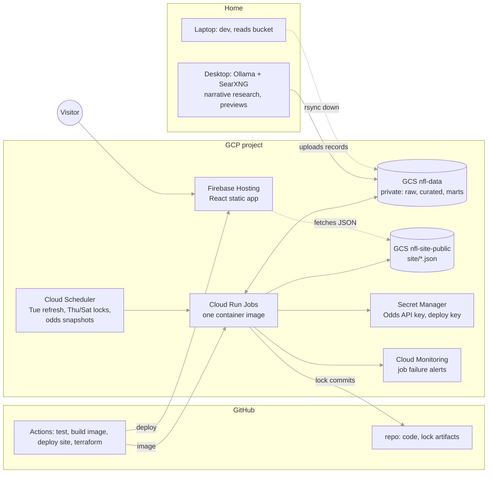

# Hosting plan (step 5)

How the project runs once it leaves the laptop, what Austin sets up by hand, and in what order. Decisions: ADR 0008 (cloud-first, Terraform, Firebase), ADR 0009 (static React site), ADR 0014 (LLM on the desktop), ADR 0015 (two runners, one bucket). Nothing here is built yet.

## 1. The shape

Four kinds of scheduled job, all the same image with different commands:

| Job | Schedule (ET) | Command | Notes |
|---|---|---|---|
| weekly refresh | Tue 10:00 | `nfl weekly refresh` then `nfl readme` + publish site | ingest, odds, curate, features, grade, ledger, site |
| lock thu | Thu 09:00 | `nfl lock --slot thu --commit --push` | commits the public artifact with the deploy key |
| lock sat | Sat 12:00 | `nfl lock --slot sat --commit --push` | |
| odds snapshot | Thu 20:05; Sun 09:20, 12:50, 16:00, 20:10; Mon 20:05 | `nfl odds snapshot` + publish site | closing lines; ~8 schedules on one job |

The desktop runs, on a Windows scheduled task: Wed and Sat early morning `nfl narrative run <season> <week> --upload` (research for every game, uploaded to the bucket), later `nfl preview run`.

## 2. What each piece does

**Container (M7.1).** One Docker image built from `pyproject.toml` with `uv`, entrypoint `nfl`. Built by GitHub Actions on every push to `main`, pushed to Artifact Registry, and the Cloud Run Jobs are updated to the new digest. The same image runs on the laptop (`docker run ... nfl lock --dry-run`) so "works in the cloud" is testable at home.

**Data root in GCS (M7.3).** The private bucket `nfl-data` holds exactly today's `./data` layout. Cloud Run Jobs mount it as a volume at `/mnt/data` (Cloud Run's native Cloud Storage volume mount), and `NFL_DATA_ROOT=/mnt/data`, so no code changes. First concern is speed: the weekly refresh scans ~2 GB of play-by-play through the mount. If that is slow, the job rsyncs the bucket to local disk at start and the marts back at the end (a small wrapper, no pipeline change). Decide after measuring the first cloud run.

**Terraform (M7.2), directory `infra/`.** Everything in GCP is declared: enabled APIs, the two buckets (with lifecycle rules: raw snapshots older than a season to Nearline), Artifact Registry, two service accounts (jobs; GitHub Actions), Secret Manager secrets (values set by hand, not in Terraform), the Cloud Run Jobs (image, command, 4 CPU / 8 GB, 2-hour timeout, bucket volume, secrets as env), Cloud Scheduler triggers, IAM bindings, Workload Identity Federation so GitHub Actions can push images and apply Terraform without a stored key, Cloud Monitoring alert policies, the Firebase Hosting site. State lives in a third small bucket created by hand once. `terraform plan` runs on every PR and posts the plan; `apply` runs on merge to `main`.

**Lock commits from the cloud.** The job clones the repo shallowly to a temp dir, runs the lock, and `nfl lock --commit --push` works as today, authenticating with a GitHub deploy key (SSH, write access to this repo only) read from Secret Manager. The push guard (lock-only commits) still applies. Code version in the artifact = the image's git sha, passed in as an env var at build time.

**Site (M7.4, M7.5).** `web/`: Vite + React + TypeScript, pages mirroring the Streamlit ones (slate, game, tracker, hypotheses, build-your-own, season, coaches, method), reading JSON from `https://storage.googleapis.com/nfl-site-public/site/...`. The build-your-own evaluator is reimplemented in TypeScript on `diy_matrix.json` (matrix math plus walk-forward Platt; the Python version is the reference and a test compares outputs). Deployed to Firebase Hosting by Actions on push to `main`; data never triggers a deploy. Custom domain optional (Firebase provisions TLS).

**Publishing site data.** After each job that changes marts, the job copies `marts/site/*.json` and `public/predictions/` to the public bucket with `Cache-Control: max-age=300` (5 minutes of CDN/browser caching). The public bucket has CORS for the Firebase origin and the domain.

**Desktop producer (M6.2L + upload).** The desktop needs read/write to `marts/narrative/` and `marts/previews/` only. It authenticates with Austin's own gcloud login (application default credentials), fine for a solo project; a service-account key is avoided. `nfl narrative run --upload` writes locally then `gcloud storage rsync` to the bucket prefix.

**Observability (M8.1).** Cloud Run Jobs report failures; alert policies email on any failed execution and on "no successful weekly refresh in 8 days". The site's `meta.json` carries data freshness; the Method page shows it; an uptime check hits `meta.json` on the public bucket.

**Local development after the move.** The bucket is the source of truth. `gcloud storage rsync gs://nfl-data ./data` pulls everything (~3 GB) for local runs; local runs never write to the bucket. Streamlit stays as the local explorer.

## 3. What Austin sets up by hand

Everything else is Terraform or Actions. Rough time: an evening.

1. **GCP account and project.** Done 2026-10-28: free trial ($300 / 90 days, billing account `My Billing Account`), project `nfl-project-prod` (number 459880554365), region `us-central1`. **Upgrade the billing account to paid before the trial's day 90 (late January 2027)** or Cloud Run, Scheduler and the buckets pause; upgrading keeps any unused credit.
2. **gcloud on the laptop (WSL).** Install, `gcloud auth login`, `gcloud auth application-default login`, `gcloud config set project <id>`.
3. **Terraform state bucket**, one command, run once: `gcloud storage buckets create gs://<project>-tfstate --location=us-central1 --uniform-bucket-level-access`. Done: `gs://nfl-project-prod-tfstate`, versioned. Phase 1 (`infra/`: APIs, buckets, registry, service accounts, empty secrets, WIF) applied 2026-10-28.
4. **Secrets, by command, after Terraform creates the empty secrets** (done 2026-10-28; the deploy key is `~/.ssh/nfl-deploy`, GitHub title "nfl-jobs (Cloud Run lock)"): the Odds API key (`gcloud secrets versions add odds-api-key --data-file=-`), and a GitHub deploy key: `ssh-keygen -t ed25519 -f nfl-deploy -N ""`, add the public half to the repo (Settings → Deploy keys, allow write), put the private half in Secret Manager, delete the local files.
5. **Firebase.** In the Firebase console, add Firebase to the GCP project (done 2026-10-28, Analytics off) and create a Hosting site (free Spark plan) when the React site exists. Optional: a domain (~$12/yr) connected in Hosting.
6. **GitHub.** Repository variables `GCP_PROJECT_ID`, `GCP_REGION`, `GCP_WIF_PROVIDER`, `GCP_DEPLOY_SA` (set 2026-10-28 from the Terraform outputs). No secrets stored in GitHub.
7. **Desktop.** `gcloud` installed and logged in with your account, for the narrative uploads.

Monthly cost estimate: storage ~$0.10, Cloud Run Jobs ~$0.50 (minutes of CPU per week), Scheduler ~$0.50, Artifact Registry ~$0.10, Firebase free, egress from the public bucket a few cents. About $1–3/month plus the desktop's electricity.

## 4. Order of work

1. **Container** (M7.1): image, CI build, run a dry-run lock from the image on the laptop.
2. **GCP bootstrap** (Austin, §3 items 1–3) and the Terraform skeleton with state in the bucket; plan/apply from Actions via WIF.
3. **Buckets and data**: Terraform the buckets; upload `./data` once; first cloud `weekly refresh`; compare its marts with the laptop's (they should match byte for byte except timestamps).
4. **Cloud locks**: Scheduler + the lock jobs + deploy key; **one shadow week** where the cloud and the laptop both lock (`--dry-run` on one side) and the artifacts are compared; then the cloud is primary and the laptop stops locking.
5. **Site**: public bucket + publish step; the React site; Firebase deploy from Actions; domain.
6. **Alerts** and the uptime check.
7. **Desktop upload path** for narrative records and previews.

Each step leaves the system working; nothing requires a big-bang cutover.

## 5. Decisions

Taken 2026-10-28 as the recommended defaults; any can be revisited: site data from the public bucket (ADR 0015); region `us-central1`; domain later (Firebase's `*.web.app` URL first); Streamlit stays local-only. WSL note: gcloud opens the browser via `$BROWSER`; set it to the Windows Brave path so logins work.

## 6. Risks

- **FUSE scan speed** on the weekly refresh: measured in step 3, with the rsync fallback ready.
- **Deploy-key hygiene**: it can push to this repo; it lives only in Secret Manager and the job's memory. Rotate if the project is ever shared.
- **Trial expiry**: the GCP free trial ends ~late January 2027; upgrade the billing account before then (§3.1).
- **Free-tier changes** on GCP or Firebase: costs are small either way; the Terraform makes the whole thing reproducible elsewhere.
- **React rewrite scope**: eight pages. The JSON contract is already what the pages read, so it's presentation work; still the largest single chunk of step 5.
