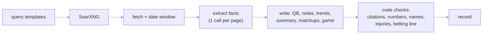

# The local narrative model: results, limits, experiments

Status: current, verified 2026-11-03 (through `local_v5`).

How the project researches each game's narrative (injuries, QB status, scheme, matchups, betting action) with an open-weight model on a home desktop instead of a paid API, what the first results looked like next to a frontier model, where the limits come from, and what moved the needle. Decisions: [ADR 0014](adr/) (local model, no paid API). Code: `src/nfl/llm/research.py`; prompts: `src/nfl/llm/prompts/`.

## Setup

- **Hardware:** the desktop has a GTX 1070 (8 GB VRAM, 2016), a Ryzen 7 3700X and 16 GB RAM. It runs Ollama and SearXNG and is reached over Tailscale.
- **Model:** `qwen3.5:9b` at 4-bit uses 6.9 of 8 GB at a 16k context and writes about 23 tokens/s.
- **Reference:** the `/nfl-narrative` Claude Code skill (Sonnet 5.5 with web search) researches the same game under the same rules. It is used only for development and comparison, never in production.

**The pipeline.** Code does everything that must be true; the model does small, schema-constrained jobs.

The model cites fact ids, never URLs, and code attaches the sources. Any sentence whose numbers, names or injury words don't appear in what it cites is dropped.

## Early results (Week 8, 2026)

**First record (v1, BAL @ BUF).** The model extracted good analysis, then lost it. Three causes:
- No scheme or matchup category existed, so analysis was filed as "form" or even "injury".
- Every page repeats the injury report, so injury facts filled 48 of the 80 prompt slots.
- Summaries were checked only for numbers. One invented a Josh Allen "history of back issues".

The fix was v2: new categories, injury facts deduplicated and capped, every sentence grounded, and a separate QB step.

**First side-by-side with the skill (v2, CHI @ SEA, Monday night).** The structured fields mostly agreed: both QBs at status 0, Seattle's injury impact at 2, and the main absences. The text did not:

| | Skill (Sonnet 5.5) | Local v2 (9B) |
|---|---|---|
| Notes per team | 8 | 5 |
| Scheme trends | 4, each backed by 2–3 sources and unit stats | 4, all single-source, one wrong (a traded player's old-team stats) |
| Matchup notes | 5, each supported by 2–4 sites | 1, cut off mid-word |
| Factual errors found | none | wrong favorite; motivation 1.0 for a Week 8 game; a "high-scoring game because of a strong defense" contradiction |

v3 fixed the causes that sat in the pipeline:
- **Betting line.** A source quote ("We opened this Bears -3") contradicted the page's own header, and the model took the quote. Records no longer state the line; the site shows the market from our own odds data.
- **Cut-off text.** Ollama enforces a schema's `maxLength` by stopping the string, not by making the model write less. Text is now trimmed to the last whole sentence.
- **Motivation.** The rating now has anchors.
- **Sources.** Stat-driven searches were added.

What remained after v3 was synthesis. The clearest example is "the Bears will deploy a heavy blitz package against Seattle's top-ranked pass defense", which pits a defense against a defense.

## Where the limits come from

**The model's size.** A model runs at full speed only when its weights and its KV cache (the working memory, which grows with the prompt) fit in VRAM. The options for this machine:

| Qwen 3.5 model | Size at 4-bit | On this machine |
|---|---|---|
| 9B (production) | 6.6 GB | fits in VRAM with a 16k context; ~23 tok/s |
| 27B | 17 GB | 8 GB on the GPU, the rest on the CPU: one QB call took 11.6 min, so it was stopped |
| 35B-A3B (mixture of experts, 3B active per token) | 22 GB | doesn't fit in 8 GB VRAM + 16 GB RAM alongside the OS |

There is no 14B in this family. Sonnet, which runs the skill, is a frontier model far larger than anything a home GPU runs. Matching it isn't the goal; closing the visible gap is.

**What a 9B does badly.** It handles multi-step reasoning over many inputs in a single pass poorly. Three examples from these games:
- **Unit pairing:** it doesn't keep track of which team's offense faces which defense.
- **Synthesis:** it restates single facts instead of combining several outlets into one point.
- **Judgment:** it picked trivia ("named a captain") as a note.

**What the setup adds on top.** These parts can be fixed:
- **Thinking was off.** Every call ran with reasoning disabled, for speed and reliable JSON.
- **One call did everything.** A single team call wrote notes, trends, ratings and a summary from up to 80 facts.
- **No examples.** The prompts described good output but never showed it.
- **Flattened analysis.** Extraction turned each article into one-sentence facts, so a preview's argument ("X matters because Y") was gone before the matchup step saw it.
- **Free-text matchup notes.** Nothing forced a note to name which offense faces which defense.

## Experiments (local_v4)

Every variant rewrites from the same extracted facts. `nfl narrative recompose` reruns only the writing stage of a saved run, and `nfl narrative compare` puts the records side by side. Changes:

1. **One job per call.** Per team: QB, notes and ratings, trends, then a summary written from those. Per game: matchup notes, then the game block.
2. **Structured matchup notes.** A `unit` note names `offense_team` and `defense_team`, and code requires them to differ. In a first test the 9B paired Seattle's offense with Chicago's blitz correctly, where free text had pitted defense against defense.
3. **Whole articles for the matchup job.** The two pages with the most analysis are read in full and cited as pages.
4. **Examples in every prompt.** They come from an invented game, so no content can leak into the output.
5. **Thinking on the reasoning jobs.** A first probe: at "low" effort the 9B wrote a correct, fully cited matchup note, but spent 4,600 tokens and 184 s on a four-fact prompt. With thinking off, it paired the units correctly in 13 s.
6. **Bigger models for the writing jobs only.** The small model still does the ~24 extraction calls.

## Results

**The structure did more than anything else.** Same 9B model, same facts, v2 against v4 on CHI @ SEA: matchup notes went from 1 (cut off mid-word) to 4, each correctly pairing an offense with the other team's defense and backed by 1-3 sites. Trends now combine 2-3 outlets. The writing stage takes about 3 minutes per game.

**Thinking didn't pay.** Qwen's thinking has no budget in Ollama (any effort level is simply "on"), so one trends call ran past 13,000 tokens.

| Thinking on | Time per game | Effect |
|---|---|---|
| none (v4 default) | ~3 min | baseline |
| matchup job only | ~4 min | fewer, vaguer matchup notes (BAL @ BUF: 2 instead of 4) |
| trends, summary, matchup | 23.6 min | slightly richer trends; Buffalo's whole summary dropped for unsupported numbers |

Thinking stays off. A thinking call gets a fixed token budget and is redone without thinking if it runs past it, so turning it back on can't fail a game.

**Bigger models: fluent, not more faithful.** Each model rewrote the same saved facts for two games (BAL @ BUF, CHI @ SEA).

| Model | On the 8 GB GPU | Writing time per game | What it did |
|---|---|---|---|
| qwen3.5:9b | fits | ~3 min | the most grounded; one unit mix-up |
| gpt-oss:20b (MoE, 3.6B active) | spills ~6 GB | ~7 min | the best prose, but contradicted its sources: a safety listed as a tackle, "missing Lamar Jackson" in the week he returned |
| qwen3:14b (dense) | small spill | ~15.5 min | the most specific matchup ideas, but put real stats on the wrong team |
| gemma4:26b (MoE, 3.8B active) | spills ~11 GB | ~98 min (one game) | the cleanest: nothing dropped, one note pitting a team against itself |

What the comparison shows:
- **Memory, not intelligence, is the binding limit on this desktop.** Past 8 GB, a model pays for CPU offload: 2× slower for gpt-oss, 5× for the dense 14B, 30× for Gemma.
- **A smarter model isn't automatically a more faithful one.** gpt-oss and qwen3:14b reason better in general but stick less closely to the facts they're given.
- **Gemma suggests a stronger model would help, but not on this hardware.**

**The errors became code checks.** Every model's mistakes fell into patterns the checks didn't cover yet, so three were added:
- **A stat on the wrong team:** the nearest team name before a number, or a player's when the sentence says "his" or "Darnold's", must be the team of a cited fact that has the number.
- **A matchup pitting a team against itself:** one team's offense and its own defense, with the opponent never named.
- **Fact ids in text:** "(F27)" is stripped before the checks, which had been dropping sentences over the "27".

Rerun over all seven saved outputs, the checks dropped exactly the three known errors and nothing else, and saved 4 gpt-oss sentences.

**Decision for v4:** production stays on qwen3.5:9b, with thinking off and the v4 structure.

## v5: each job on the model that does it best

The comparison was per job, so the next step was to stop choosing one model. The 9B was better at notes (correct kinds), trends, QB status and summaries; the 14B had the sharper matchup ideas. v5 writes the matchup job on qwen3:14b and everything else on the 9B (`JOB_MODELS` in `research.py`). The matchup call runs last, so Ollama swaps models twice a game; if the 14B fails, the call is redone on the 9B rather than failing the game.

| Matchup job, after all checks | v4: 9B | v5: 14B, thinking off | 14B, thinking on |
|---|---|---|---|
| Notes, BAL @ BUF (sites behind each) | 4 (3,2,2,4) | 5 (3,4,2,2,3) | 2 (3,2) |
| Notes, CHI @ SEA | 4 (3,1,3,2) | 3 (3,1,4) | 2 (2,1) |
| Known errors left | 1 unit mix-up | 0 | 1 (32.8 points scored written as allowed) |
| Writing stage per game | 3.1 min | 5.3 min | 8.6 min |

With thinking on, the 14B wrote the same notes as before, errors included. With thinking off, it wrote cleaner offense-against-defense pairings, backed by a few more sites. Two of them pitted one defense against the other ("Chicago's aggressive blitz package faces Seattle's top-ranked pass defense"), so the pairing check now drops that too.

On two games the gain is small: the 9B was more specific (named cornerbacks, the 41-40 last meeting), the 14B cleaner. v5 costs about 35 minutes a week, so it runs in production from Week 9, and the 9B-only version is recomposed on the same facts for a larger comparison.
