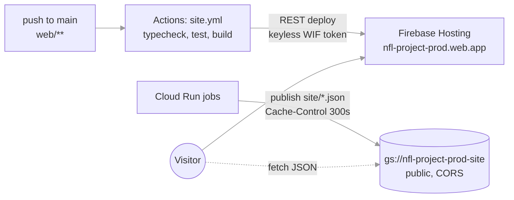

# The public site (M7.4, M7.5)

A static React app on Firebase Hosting that reads the published site JSON from the public bucket. Decisions: ADR 0009 (static site, no API), ADR 0015 (data from a public bucket, so data changes never need a deploy). The Streamlit app stays as the local explorer; this replaces it as the public face.

## How it fits

- **App:** `web/`, Vite + React 19 + TypeScript, React Router, TanStack Query (fetch + cache), zod (runtime contract checks), Tailwind 4 (layout), Recharts plus small hand-written SVG charts (dot-and-whisker, dumbbell, diverging bars) on `d3-scale`. Vitest + Testing Library.
- **Data:** `VITE_DATA_URL` (default `https://storage.googleapis.com/nfl-project-prod-site`). Pages fetch `site/meta.json`, `site/slate_<season>_<ww>.json`, `site/game/<id>.json`, `site/tracker.json`, `site/hypotheses.json`, `site/coaches.json`, `site/diy_matrix.json`, `site/season_<yyyy>.json`, `site/audit.json`, and lock artifacts under `predictions/`. In `npm run dev`, a small Vite plugin serves the local `data/marts/site` at the same paths, so the app runs against your laptop's data with no bucket.
- **Contract:** TypeScript types and zod schemas in `web/src/data/contract.ts` mirror `src/nfl/site.py`. A test parses every real JSON file under `data/marts/site` (skipped when absent) and checked-in fixtures (always), so a contract change in Python that breaks the site fails CI.
- **Build-your-own in the browser:** the evaluator (walk-forward Platt, metrics, buckets, season view, fit-toward-you ridge) is ported to TypeScript in `web/src/diy/`. A parity test compares it with Python's `nfl.approaches.diy.evaluate` on fixed weight sets (fixtures generated by `scripts/web_fixtures.py`).
- **Deploy (M7.5):** `scripts/firebase_deploy.py` uses the Firebase Hosting REST API (create version with config, populate file hashes, upload gzipped files, finalize, release) with a token from `gcloud auth print-access-token`. That's keyless in Actions (Workload Identity, the existing `nfl-deploy` service account has `firebasehosting.admin`) and works locally with your gcloud login. Chosen over the Firebase CLI because current CLI releases have open reports of ignoring Workload Identity credentials in CI, and the official deploy action still needs a stored key. Hosting config sent with each version: SPA rewrite to `/index.html`; `Cache-Control: public, max-age=31536000, immutable` for hashed `/assets/**`, `no-cache` for HTML; a CSP that allows fetches only from self and `storage.googleapis.com`.
- **Workflow:** `.github/workflows/site.yml` on pushes to `main` touching `web/**` (and manual dispatch): `npm ci`, typecheck, lint, test, build, deploy. `ci.yml` gains a web job (typecheck, test, build) for pull requests.

## Pages (mirror the Streamlit ones, with the React-only items from `.notes/ui-feedback.md`)

| Route | Page | Reads |
|---|---|---|
| `/` | Slate: the week's games × approaches, divergence markers, statuses, disagreement strip | meta, slate |
| `/game/:id` | Game: approaches vs market, why (group contributions in win-probability points), edges by group, tale of the tape, tendency dumbbells vs league, injuries, narrative v2 | game |
| `/tracker` | Season tracker: current-season curve, backtest Δ with CIs, calibration question, divergence sentences, paper bets, persona vs history | tracker, meta |
| `/hypotheses` | What history says per feature; one feature or group over time | hypotheses |
| `/coaches` | Team view and coach view of coordinator scheme profiles | coaches |
| `/build` | Build your own: group budget, donut by heading, results; shareable `?w=` | diy_matrix, meta |
| `/season/:year` | Every game of a season under a weight set | season_<yyyy>, diy_matrix |
| `/method` | How it works, honest limits, leaks found, freshness, audit | meta, audit |

Global: header nav, "last updated" from `meta.generated_at` and the last lock, footer with credits and the "fan-made, not affiliated with the NFL" line, light/dark theme from the dataviz palette tokens, hover help on every feature/group/metric (descriptions from `meta.groups`), mobile-friendly layouts (tables scroll horizontally, charts reflow).

## Work order

1. **Foundation (main session):** scaffold, data layer + contract + fixtures, design tokens and shared components (Help, Section, StatTile, ModelBadge, StatusBadge, ProbCell, chart kit), app shell and routes with placeholders, dev data plugin, tests. Tendency metric labels added to `meta.json` (a contract gap the Streamlit pages hard-coded).
2. **Pages (four implementer agents in parallel):** slate + game; tracker + method; hypotheses + coaches; build-your-own + season + the TypeScript evaluator with its parity test.
3. **Deploy (main session):** the REST deploy script, `site.yml`, the CI web job, a local `npm run build && preview` check.
4. **Review, then first deploy:** a reviewer pass over `web/`, then (with Austin's go-ahead, since it publishes) a first manual deploy and the push that turns on the workflow.

## Out of scope for now

Custom domain (Firebase's `nfl-project-prod.web.app` works), analytics, server-side rendering, historical per-game pages before 2026.
