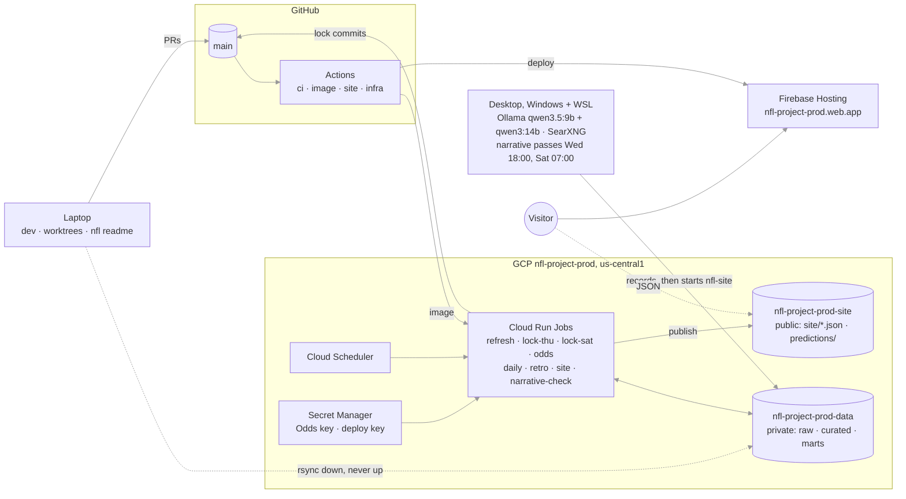

# State of the project

Where the project is right now. Chats keep it current as they work ([state-maintenance.md](state-maintenance.md)); `scripts/state_check.py` checks the mechanical parts at every session start, before every PR and in CI. How we got here: [journal.md](journal.md). What's next: [tasks.md](tasks.md). Why: [adr/](adr/). How we work: [../CLAUDE.md](../CLAUDE.md).

## Bottom line (as of 2026-11-08)

The pipeline, the public site and the desktop narrative passes run on schedules; the first public lock landed Thursday 2026-11-05 at 09:07 ET (`c8d8103`), on model wave 2 (ADR 0018). Wave 2 is football features only, line moves capped at 4.5 points, special teams as a group, the Student as the headline line and the ensemble retired. UI round 2 finished 2026-11-05 (#17), and the site walk fixes followed (#18). The League page is finished and live (M14, #20, #23, #24): playoff odds on two variants, standings, leverage, team charts, similar seasons and slate stakes lines. The retro's win-probability chart, motion, drives and pinned result are live too (M15, #19, #21, #22). Coaches and Build are hidden from the live site until they're better (M16): nothing removed, both still in `npm run dev`. Team pages are live (M18, #27): staff with sources, coach profiles, and tendencies against the caller's confirmed past and last season. M20, the predictions against the market, is live (#29, 2026-11-08; ADR 0024): the Student's spread beside every pick, an expected score from the new total, "The line" tab with the movement and where the sportsbooks disagree, the quarterback what-if and swing list, live readings on the Preview, and a strong-calls ledger on the tracker; its first daily pass and first lock with calls and totals are still to check. Then the narrative's previews and evals (M6.3, M6.4).

## What runs where

| Machine | Runs | Never runs |
|---|---|---|
| Cloud Run Jobs | refresh, odds snapshots, locks, retros, site rebuilds, the narrative check; `nfl publish` after each | anything LLM; `nfl readme` |
| Desktop | narrative research on the local models (ADR 0014), uploads to the data bucket | locks, grading, the site |
| Laptop | development in worktrees, `nfl readme`, hand reruns, `rsync` of the bucket down | odds snapshots (credits), locks (cloud is primary; laptop is the fallback) |
| Firebase | the static React app | data (the app reads the public bucket, 5-minute cache) |

### Schedule (ET)

The cloud rows are checked against `infra/jobs.tf` by `scripts/state_check.py`; the desktop rows against `PASSES` in `src/nfl/llm/narrative.py`. `uv run nfl status` shows the last run of every row at once (the hub's Status tab runs `nfl status --json`).

| When | What | Where | Cron | Writes | Check it ran |
|---|---|---|---|---|---|
| Tue 10:00 | `nfl-weekly-refresh`: ingest, odds, curate, features, score unscored finished games, grade, ledger, site, publish | cloud | `0 10 * * 2` | marts, site JSON | `gcloud run jobs executions list --job nfl-weekly-refresh --region us-central1` |
| Wed 18:00 | `desktop-narrative-wed`: desktop narrative pass, every game of the week; uploads records, starts `nfl-site` | desktop | `wed 18:00` | `marts/narrative/` | `gcloud logging read 'logName="projects/nfl-project-prod/logs/nfl-desktop-narrative"' --limit 5` |
| Thu 08:30 | `nfl-narrative-check`: fails (emails) if an upcoming game has no `local` record since the last pass | cloud | `30 8 * * 4` | nothing | executions list |
| Thu 09:00 | `nfl-lock-thu`: lock the Thursday games, commit + push the artifact | cloud | `0 9 * * 4` | predictions, bets, `public/predictions/` on `main`, site | `git log origin/main -1`; executions list |
| Thu 20:05 | `nfl-odds-snapshot`: closing lines for CLV, publish | cloud | `5 20 * * 4` | `curated/lines`, site | executions list |
| Wed, Fri, Sat 20:05 | `nfl-daily`: this season's ingest, an odds snapshot, curate, tendencies, features, site, publish (ADR 0024) | cloud | `5 20 * * 3`, `5 20 * * 5`, `5 20 * * 6` | lines, features, site | executions list |
| Sat 07:00 | `desktop-narrative-sat`: desktop narrative pass, Sunday and Monday games (after Friday's designations) | desktop | `sat 07:00` | `marts/narrative/` | desktop log |
| Sat 11:30 | `nfl-narrative-check` | cloud | `30 11 * * 6` | nothing | executions list |
| Sat 12:00 | `nfl-lock-sat`: lock every Saturday to Monday game | cloud | `0 12 * * 6` | as Thursday | as Thursday |
| Sun 09:20, 12:50, 16:00, 20:10 | `nfl-odds-snapshot` | cloud | `20 9 * * 0`, `50 12 * * 0`, `0 16 * * 0`, `10 20 * * 0` | lines, site | executions list |
| Mon 20:05 | `nfl-odds-snapshot` | cloud | `5 20 * * 1` | lines, site | executions list |
| Daily 07:00 | `nfl-retro`: ingest the current season, build missing or stale retros and week recaps, publish | cloud | `0 7 * * *` | `marts/retro/`, `site/retro/`, `site/recap_*` | executions list |
| On demand | `nfl-site`: rebuild and publish the site JSON (started by the desktop after an upload) | cloud | none | site JSON | executions list |
| Push to `main` | `ci` (ruff, pytest, web typecheck/lint/test/build), then `image` when job code changed and `site` when `web/` changed; `infra` plans on PRs and applies on `main` | GitHub | none | Artifact Registry, Firebase, GCP | [Actions](https://github.com/austin-chemelli/nfl-project/actions) |

About 33 Odds API credits a week (daily snapshots from M20, ADR 0024). A failed cloud execution and a failed desktop pass each email Austin; nothing retries by itself. The lock job refuses to run if `main` has job-code commits newer than its image. An image builds in 3 to 4 minutes, so job code can merge anytime except the last 10 minutes before Thu 09:00 and Sat 12:00; a refused lock emails and can be rerun by hand (`docs/runbook.md`, Merging job code).

### Links

- Site: <https://nfl-project-prod.web.app>. Data freshness: <https://storage.googleapis.com/nfl-project-prod-site/site/meta.json>.
- GitHub: [repo](https://github.com/austin-chemelli/nfl-project), [PRs](https://github.com/austin-chemelli/nfl-project/pulls), [Actions](https://github.com/austin-chemelli/nfl-project/actions).
- GCP (`nfl-project-prod`): [Cloud Run jobs](https://console.cloud.google.com/run/jobs?project=nfl-project-prod), [Scheduler](https://console.cloud.google.com/cloudscheduler?project=nfl-project-prod), [Logs](https://console.cloud.google.com/logs/query?project=nfl-project-prod), [data bucket](https://console.cloud.google.com/storage/browser/nfl-project-prod-data?project=nfl-project-prod), [site bucket](https://console.cloud.google.com/storage/browser/nfl-project-prod-site?project=nfl-project-prod), [Artifact Registry](https://console.cloud.google.com/artifacts?project=nfl-project-prod), [Secret Manager](https://console.cloud.google.com/security/secret-manager?project=nfl-project-prod), [Alerts](https://console.cloud.google.com/monitoring/alerting?project=nfl-project-prod), [Billing](https://console.cloud.google.com/billing?project=nfl-project-prod).
- Firebase: [Hosting](https://console.firebase.google.com/project/nfl-project-prod/hosting).
- Odds API: `uv run nfl odds status` (credits used); account at <https://the-odds-api.com/>.
- Desktop: `docs/desktop-llm-setup.md`; Task Scheduler task `nfl-narrative`; logs in `data/raw/narrative_local/passes/` on the desktop.

## Workstreams

Live view, with the areas each chat has claimed: `.notes/hub/tracks/` (uncommitted, shared by every worktree), shown by the project hub at <http://localhost:8765/nfl-project/>. This table is the durable version: one row per track, updated when a track starts, opens a PR and finishes.

| Track | Branch | Worktree | Goal | Status (date) | PR |
|---|---|---|---|---|---|
| status-check-resolved | `status-check-resolved` | removed | `nfl status` shows a failed `nfl-narrative-check` as resolved once a later desktop pass in the same window logs done (the Sat 2026-11-07 failure stayed red for days) | merged 2026-11-11; worktree and branch removed, track archived | #45 |
| status-feed | `status-feed`, `status-desktop-ids` | removed | Hub v2 track N1 (plan in `~/dev/t3code/.notes/hub/plans/hub-v2.md`, Contract B): `nfl status --json` reports the last run of every cloud job, the desktop passes, site freshness, the last lock commit and Odds API credits for the hub's Status tab; `hub.toml` gains `[[status.source]]` | merged 2026-11-11. Follow-up PR: the two desktop rows of the schedule table start with their ids (`desktop-narrative-wed`, `-sat`) so the hub's This week strip ticks them (merged 2026-11-11). Worktree and branches removed, track archived. The hub's Status page (thread "Hub: Status") consumes it | #43, #44 |
| league | `league-teams`, `league-playoffs`, `league-context` | removed | M14 league page in three phases (ADR 0019): Teams tab with scatter charts and the `feature_bands` fix; standings, simulated playoff odds, leverage, slate stakes line; similar seasons, compare, ranks | merged 2026-11-06, all three phases live and checked in production. The first real snapshot lands with Saturday's lock: check the job log for `SNAPSHOT NOT SAVED` | #20, #23, #24 |
| pop | `retro-wp`, `retro-drives`, `retro-story` | removed | M15 (ADR 0020): win-probability chart with turning points, motion tokens and kit motion, skeletons, touch tips; drives; pinned result | merged 2026-11-05, all three phases live; `nfl-retro` run by hand on d969ab3, retros on schema 6; worktree and branches removed. M15.10 route crossfades optional, not built | #19, #21, #22 |
| ui | `ui-copy`, now `ui-next` (idle) | `~/dev/nfl-project-ui` | M21 copy pass: shorter ledes, explanations behind hover and fine print, parallel sentences as tables, team codes in sentences (ADR 0017 amendment); earlier: site walk fixes and the approach-free Preview (#30), Coaches and Build hidden (#25), M13 (#18), round 2 | merged 2026-11-09 (#31); worktree kept for the next UI round | #31 |
| players | `player-ingest`, `player-value` | `~/dev/nfl-project-players` | M24.0 sources and M24.1 status-to-play rates, M24.2 value model (ADR 0027) | M24.0/M24.1 merged 2026-11-09 (#33); M24.2 PR open; M24.4 waits on Austin's go (D33) | #33, #34 |
| market | `market-swings` | removed | M20: line history, daily pass, previews, what-ifs, strong calls, weather, the total | merged 2026-11-08, worktree and branches removed. Check the first daily pass and the next lock (strong calls, `student_total` in the lock file). Follow-ups: prediction-market prices (waiting on Austin's legal check), strong calls checked against the books' range | #29 |
| data | `data-catalog`, `data-writes`, `calibration`, `candidates`, now `matchups` | `~/dev/nfl-project-data` | M22 (ADR 0025) done. M23 (ADR 0026) phase 0: the Student v2 (calibration), the SQL models and the candidates ledger. Next: M25 Matchups and paths to an upset (splits and matchups as context, upset paths, justified market disagreements; edges only through a separate approach), to be planned on Fable from `.notes/matchup-insights-direction.md` | M23.0-M23.3 live 2026-11-09 (#35, #37); `student_v2` fits uploaded, backfilled and graded under the job lock, `nfl-site` rerun, README updated (2878876); its live record starts Week 10 | #35, #37 |
| model-wave2 | `model-wave2`, `qb-charted-starter` | removed | `.notes/ui-round2.md` §6: line-move cap, scheme groups zeroed, pressure rate into Defense, special-teams group, ensemble demoted (the QB fix ships ahead on its own branch); one `model_version`, live before the first public lock | merged and cut over 2026-11-04; worktree kept until the first lock passes (rollback backup) | #12 |
| project-state | `project-state` | removed | this hub, the board, the maintenance checklist, hooks and CI guard | merged 2026-11-04, hooks registered in `.claude/settings.json` | #7 |
| hub | `hub-setup`, `hub-next` | removed | the project hub (`~/dev/hub`, its own repo): `hub.toml`, `.notes/hub/` replaces `.notes/board.md` as the live layer, the session hook injects the thread's own track file and the hub rules, `state_check` reads track files | merged 2026-11-10; worktree and branches removed, track archived. Further hub and T3 fork work belongs to `~/dev/hub` and `~/dev/t3code` (the `dev` master thread) | #39 |
| harness | `harness-concise` | removed | shorter session-start digest (~37 KB to ~5 KB) and Writing for Austin rules in CLAUDE.md | merged 2026-11-09, worktree and branch removed | #38 |
| hooks | `hooks-dev-folder`, `hooks-log` | removed | the state hooks at the `~/dev` level, executable bit, run log | merged 2026-11-04; hooks verified firing on resume | #8, #9 |
| narrative-sources | `narrative-sources` | removed | fix the 2026-11-04 pass failures: feeds and Tavily before search, resumable passes, failure detail, reset instead of pull | merged 2026-11-05, image `c12c6a5`; worktree and branch removed; first desktop pass on it finished 2026-11-05 06:32Z with 15 of 15 games | #15 |
| narrative | `narrative-m6.2u`, `desktop-task-fix`, `locks-live` | removed | desktop narrative schedule, the desktop task fixes, locks live | merged 2026-11-04; worktrees and branches removed; task registered on the desktop, first pass 2026-11-04 18:00 ET | #1, #5, #6 |

## Milestones

| Milestone | Status |
|---|---|
| M0–M3 hygiene, feature store, approaches, odds + ledger | done 2026-10-27 |
| M4 first public lock (`nfl lock`, refresh, runbook) | built 2026-10-27; first live cloud lock Thu 2026-11-05 |
| M5 Streamlit pages, hypotheses, DIY, coaches | done 2026-10-28 (local explorer only) |
| M6 LLM layer | M6.1, M6.1b, M6.2L (v1–v5), M6.2e, M6.2u done by 2026-11-03; desktop task registered 2026-11-04; **next: M6.3 previews + faithfulness, M6.4 evals, M6.5 Narrative approach in shadow**. After Week 9's passes: recompose the 9B-only matchup on the same facts to compare with v5; parked: M6.6 follow-up searches, M6.7 hosted agent (D3) |
| M7 hosting (container, Terraform, buckets, cloud locks, React site) | done 2026-10-29; locks live from Week 9 |
| M8 observability | alerts done; uptime check on `meta.json` and a data-freshness alert still open |
| M9 game retrospective (ADR 0016) | done 2026-11-02 |
| M10 site v2, one answer first (ADR 0017) | done 2026-11-04 (PR #4) |
| M11 model wave 2 (ADR 0018) | done 2026-11-04 (PR #12), live before the first public lock |
| M13 site walk fixes (review §10) | done 2026-11-05 (PR #18), live; retros on schema 5 |
| M14 league page (ADR 0019) | done 2026-11-06 (#20, #23, #24), live; odds history starts with Tuesday's refresh |
| M15 retro win probability, motion, drives, story (ADR 0020) | done 2026-11-05 (#19, #21, #22), live; retros on schema 6; M15.10 route crossfades optional, not built |
| M16 Coaches and Build back on the site | Coaches picked up 2026-11-06 as M17 (ADR 0021): staff table, study and team data files merged (#26), 2026 verified; team page next (M18); both pages still hidden. Build: with the custom-approach work |
| M18 Team page | done 2026-11-07 (#27, ADR 0022): `/team` in the nav, staff with sources, coach profiles, tendencies vs the caller's confirmed past |
| M19 site name and custom domain | parked 2026-11-07: researched, waiting on Austin's calls (domain, display name, repo rename). Plan: `.notes/plans/rename-and-domain.md` |
| M20 spreads and totals, market movement, swing factors, strong calls | live 2026-11-08 (#29, ADR 0024): movement, where the books disagree, previews, what-ifs, strong calls, spread beside the pick, weather, the total |
| M21 copy pass | live 2026-11-09 (#31): web only; pipeline sentences (M21.8) wait on Austin (D30) |
| M22 data catalog and safe writes | phases 0-2 live 2026-11-08 (#32, ADR 0025): fixtures collapsed in diffs, `nfl sql` over every table, safe writes and a job lock; M22.3 SQL models moved to M23.3 |
| M23 second-level features | planned 2026-11-08 (ADR 0026): calibration study first (the Student carries a home shift from pooling 2002+: favorites at 0.55-0.75 win 3-5 points less than it says), a candidates ledger that keeps every tested feature on the History page, EPA without turnovers / takeaways / fumble luck into the existing groups via a shadow `student_v2`, `DecompBar` and `ReliabilityBadge`, the context splits; player-level data is another chat's flight |
| M24 Player value and scored impact claims | M24.0 sources and M24.1 status-to-play rates live 2026-11-09 (#33, ADR 0027); M24.2 value model in PR #34; M24.4 waits on D33; screening waits on M23 phase 0 |
| M25 Matchups and paths to an upset | planned 2026-11-09 (ADR 0028): situation splits as a SQL model and a matchup engine (edges in points, shrunk toward the league effect, badged), paths to an upset as conditions and plausibility (pre-game rates predict a game's turnover margin with r 0.00, so never a probability), market leans from the ledger, a Matchups tab, `UpsetPaths` and `MatchupGrid`; phases 0-2 are site work in season, phase 3 (a `matchup` approach beside the Student) is offseason and gated; nothing built |
| Feature wave (M1.13 FTN extras and matchup interactions, Matchup approach) | parked for the offseason |

## Open decisions

| Id | Question | Options | Waiting on | Raised |
|---|---|---|---|---|
| D1 | Keep the production number audit (`.notes/audit_site.py`, uncommitted) as a CI or post-publish check? | (a) a step after `nfl publish` that fails the job; (b) a CI check against the public bucket; (c) leave it manual | Austin's call; a chat can build (a) in a day | 2026-11-03 |
| D2 | Tendencies on the league band too (`RangeRow` over `tendencies.parquet`), the follow-up ADR 0017 left out? | (a) next UI round; (b) not worth it | the next UI look | 2026-11-03 |
| D3 | How should narrative research get smarter? Plans in `docs/tasks.md` (M6.6, M6.7) | (a) M6.6: one model-proposed follow-up search per game in the local pipeline, a few hours, free; (b) M6.7: hosted free-roaming agent on API credits, better writing and no desktop dependence, but reverses the no-paid-API rule; (c) leave it as it is | Austin; both parked, neither scheduled | 2026-11-05 |
| D34 | A better knowledge-base tool for cross-chat tracking than `.notes/board.md`? (was listed as a second D3) | **decided 2026-11-10: the project hub (`~/dev/hub`, `.notes/hub/`), `.notes/project-hub-plan.md` in `~/dev`** | Austin | 2026-11-04 |
| D10 | Betting integration (§5): which venue is lawful where Austin lives; then read-only prices only, or execution with a fixed small stake? | legal check first; read-only / execute | **dropped 2026-11-11 (Austin)**: researched (Odds API `us_ex` carries Kalshi and Polymarket US prices; Kalshi's own API bans sharing its data; every line loses money in the backtest), not building | 2026-11-05 |
| D11 | GPU for the desktop (§6): a 24 GB card to run 27–32B models, or stay on the 1070 with prompts and evals only? | buy / stay | Austin's money | 2026-11-05 |
| D12 | Learned Student (§3.1): a fifth line in shadow (recommended) or a replacement for the Student? | shadow / replace | Austin | 2026-11-05 |
| D13 | Player-level data (§2.2) | **decided 2026-11-08: scored impact (ADR 0027, M24); context-only until a shadow line earns it; props parked; QB, WR/TE, RB, OL, EDGE, CB/S in v1** | Austin | 2026-11-08 |
| D14 | A backup lock run 30 minutes after each lock that acts only if the first didn't, so a badly timed merge fixes itself? | (a) build it, about an hour, plus an "already locked?" check; (b) leave reruns manual | Austin, after the first public lock | 2026-11-04 |
| D15 | Coaches refinement (ADR 0021): where the per-team view lives | **decided 2026-11-06: a team page `/team/:code`, linked from game previews and wherever a team is named** | Austin | 2026-11-06 |
| D16 | Staff verification depth | **decided 2026-11-06: 2016–2026 (where scheme data exists), full bar 2022+, light bar before; five research agents launched 2026-11-06** | Austin | 2026-11-06 |
| D17 | Team page (ADR 0022): nav and slate cards | **decided 2026-11-06: in the top nav as Teams, with `/team` listing all 32; no links on slate cards, links on the game page** | Austin | 2026-11-06 |
| D18 | Daily odds snapshots (ADR 0024): add Wed, Fri, Sat 20:05, about 33 credits a week? | **decided 2026-11-07: yes** | Austin | 2026-11-07 |
| D19 | A totals line (ADR 0024): scored from its first lock in its own block, labelled context, or unscored? | **decided 2026-11-07: scored, as context and for fun; never the headline** | Austin | 2026-11-07 |
| D20 | A daily preview score of upcoming games between locks, labelled and never graded? | **decided 2026-11-07: yes, with the label** | Austin | 2026-11-07 |
| D21 | Explanations of disagreements: templates now, LLM later? | **decided 2026-11-07: no LLM in this flight** | Austin | 2026-11-07 |
| D22 | Second-level features (ADR 0026): fix the Student's calibration before judging any feature against it? | **decided 2026-11-08: yes, M23.0 first** | Austin | 2026-11-08 |
| D23 | When a recalibrated or extended Student beats the public one in shadow: swap mid-season (a second `model_version` in the public record from that week) or at the offseason refit? | **decided 2026-11-08: neither for now. The new line is its own approach (`student_v2`), shown beside the Student; the Student stays the headline** | Austin | 2026-11-08 |
| D24 | New features join the existing groups, or a new "luck" group? | **decided 2026-11-08: existing groups** | Austin | 2026-11-08 |
| D25 | Keep failed candidates visible (ledger + History page "Tested, not used") and build `DecompBar` + `ReliabilityBadge`? | **decided 2026-11-08: yes to both; player-level data stays in its own chat** | Austin | 2026-11-08 |
| D26 | Paths to an upset: the lead of M25, or one part of it beside the split library and the matchup engine? | **decided 2026-11-09: one part of it** | Austin | 2026-11-09 |
| D27 | Coverage and personnel splits in season: last season's numbers labeled "2025", or out until the 2026 participation file lands? | **decided 2026-11-09: out until February** | Austin | 2026-11-09 |
| D28 | Matchup edges into the Student, or only a separate `matchup` approach beside it? | **decided 2026-11-09: separate approach only; the Student never carries them** | Austin | 2026-11-09 |
| D29 | Paths as conditions and plausibility (never a probability; the headline chance doesn't move) and a per-game market lean from the ledger's `use` candidates, shown as context with a live record? | **decided by default 2026-11-09 (ADR 0028), Austin to object** | Austin | 2026-11-09 |
| D30 | M21.8: shorter pipeline sentences (needs a measured `SCHEMA_VERSION` rebuild), and the phone injury-table overflow as its own small PR? | do both / sentences only / leave | **dropped 2026-11-09 (Austin)** | 2026-11-08 |
| D31 | A weekly league-wide note from the desktop model (firings, benchings, major injuries, headlines) on This Week, also feeding the staff table (M17.4; `.notes/project-review-2026-11.md`, `coaches-refinement.md` §7)? Austin: "id like to maybe look into that soon" | plan it / later | **dropped 2026-11-09 (Austin)** | 2026-11-06 |
| D32 | Desktop pass hardening: lock push retries, "wake the computer to run this task" (`WakeToRun`), a pre-flight memory and restarting-container warning in `scripts/desktop-narrative.sh` | build / drop each | **dropped 2026-11-09 (Austin)** | 2026-11-07 |
| D33 | Start M24.4 now (M24.3 waits on the M23 ledger)? | go / wait for #34 to merge | Austin | 2026-11-09 |

**Recently closed** (kept two weeks; the ADR or journal entry holds the record):

- D9 League page tiebreaks: the real procedure through strength of schedule, then a seeded coin flip (Austin, 2026-11-05, ADR 0019). A scratch engine reproduced 48 of 48 conference-seasons' seeds, so it is M, not L.
- D4 Preview bars are scaled by the Global fit (Austin, 2026-11-04).
- D5 The Student stays as the data-only public line; the ensemble is demoted to a diagnostic like Global and leaves the site, README and tiles (Austin, 2026-11-04). Its lock rows keep being written until wave 2 drops it.
- D6 Model wave 2 scoped (Austin, 2026-11-04; `.notes/ui-round2.md` §6): quarterback-group fix, line move winsorized and given to the Student and Analyst, coaching and both scheme groups zeroed in every line, special teams promoted to its own group, ensemble stops locking. One `model_version` at the Week 10 Thursday lock.
- D7 folded into D6.
- D8 Retro names: "Swing plays" and "Pure luck" (Austin, 2026-11-04).

- Who locks Week 9: the cloud (`locks_paused = false`, PR #6, merged 2026-11-04), without the planned shadow week, to find the problems on the first live weekend. The laptop is the fallback.
- Narrative timing: two passes, Wednesday evening for every game and Saturday morning for the Sunday and Monday games; the newer record supersedes with no reconciliation code (journal 2026-11-03).
- Narrative models: `qwen3.5:9b` plus `qwen3:14b` for the matchup job, thinking off; gemma4 and gpt-oss dropped (journal 2026-11-03).
- Site layout: tabs plus a summary strip, thin team-color accent, matchup cards, retro as the default tab (ADR 0017, 2026-11-03).
- Branch and worktree cleanup after a merge happens without asking (CLAUDE.md, 2026-11-04).
- The live coordination layer stays uncommitted in `.notes/` (journal 2026-11-04); since 2026-11-10 it is `.notes/hub/` (one track file per thread), shown by the project hub.
- Docs maintenance is automatic at boundaries, not a weekly audit (journal 2026-11-04).

## Known issues and risks

- **A league build failure is silent** (M14): `site.build` prints and carries on, so the job stays green with no email, and a lost snapshot can't be backfilled. Grep `league.json failed` or `SNAPSHOT NOT SAVED` in the job logs until there is a log-based alert. Snapshots are one read-modify-write file, so a manual run overlapping a scheduled one can lose rows.
- **Baltimore's Week 9 starter is uncertain.** Tyler Huntley missed Wednesday's practice and Joe Fagnano took full reps. The lock uses the depth chart nflverse has at 09:00.
- **First live locks** Thu 2026-11-05 09:00 and Sat 2026-11-07 12:00: watch the executions and the lock commits; the laptop fallback is `uv run nfl lock --slot thu` in the primary checkout. Thursday's is the first push from the cloud: dry runs don't push, so the deploy key's write access is confirmed but the push itself is untested.
- **Desktop passes** 2026-11-05: the pass on #15 stored the 7 missing games (15 of 15 in the bucket, 06:32Z), Tavily served its queries (51 credits used), the 08:30 check passed and the first public lock landed (`c8d8103`, JAX @ BAL). Open: (1) games took 26.5 minutes each, against about 16 for full games on the search-only pass. Feed pages take about 32 seconds each against 21 in Week 8 (n=8, one game), because they yield more facts, which accounts for about 6 of the 10 extra minutes. At that rate Saturday's 14 games end about 13:10 ET, after the 11:30 check, which would email a false failure because uploads come last; the lock doesn't depend on it, and Saturday's fewer queries won't shorten the model time. (2) `push_locks` tries once and the job has no retries, so a GitHub push error fails the lock job; rerun it before kickoff. A docs push failed that way twice on 2026-11-05 (`fatal error in commit_refs_rules`) and passed 28 minutes later. (3) LA @ WAS (14 claims, 2 pages) and NYG @ PHI (4 pages) are thin leftovers from the blocked run; Saturday's pass replaces them. 2026-11-07: the Saturday pass started at 11:22 ET and stalled before loading a model, because the desktop was out of memory: two unrelated Docker containers had been restart-looping for 9 days after a file they load was moved. The 11:30 check failed (14 games, correctly); Austin restarted the pass at 12:34 ET; it finished at 16:02 ET with 14 of 14 records (about 15 minutes a game) and the site rebuilt at 16:08. The Saturday lock landed on time (`d4980f7`).
- Game page, from the League site walk (`.notes/site-walk/2026-11-05-4/report.md`): "JAX, 48th pct" is the size of the edge among matchups, and reads as a contradiction beside a rank-3 offense; a scheme label loses its closing parenthesis; Details rows print equal rounded values with dots far apart. Small; the pop track owns those files.
- The learned-Student experiment (2026-11-05, `.notes/plans/learned-student.md`): a GBM on the same matrix loses to the Student by 0.0033; "Student + trees" ties. Not building it now. Also found: `.data-prod` in the UI worktree is stale (features from Oct 28); `schema.py` defines a `shadow` flag no code reads.
- Follow-up to wave 2: the retro's kicking luck should read against the kicker's own season rate (`src/nfl/retro/game.py`, after the UI retro PR).
- A correction to an earlier game doesn't mark later retros stale (accepted 2026-11-03; the daily job only rehashes each game's own inputs).
- NO @ NYG Week 6: the books' spread and moneyline disagree on the favorite at a coin flip. Real market data, not a bug.
- The GCP free trial ends about late January 2027: upgrade the billing account before then (`docs/hosting.md` §3.1).
- M8 leftovers: no uptime check on `meta.json`, no data-freshness alert; bucket object versioning is off (review §7).
- The League team panel can be a game behind the standings: the shared team-numbers file takes records from the last feature build (about an hour to fix; not started, 2026-11-07).
- Elo on JAX @ BAL reads 44.8 on the page and 39.8 in the lock (2026-11-05; unexplained).
- Coach profiles go stale when a coach moves or a new one arrives; the research has to be rerun by hand (2026-11-07).
- The game page's injury table overflows a 375 px phone by 51 px (2026-11-08; D30 dropped, no fix planned).
- Wednesday 2026-11-11 desktop pass tests whether Saturday's speed-up (about 15 min a game against 26.5) came from removing stale Docker containers rather than from feed pages.
- README scorecard CIs change between `nfl readme` runs: on 2026-11-03 only the bootstrap CI digits moved (point estimates and counts identical), although `grade.py` seeds its RNG. Cause unverified; that run's README change was discarded.
- `tests/test_ui.py` fails on the Streamlit Build page (`diy`): `KeyError: 'special_teams'` in `src/nfl/ui/pages/diy.py` `donut` (line 133), since wave 2 made special teams a group the page's heading map lacks. Local data only, so CI stays green. Build is hidden from the live site (M16); fix when Build comes back (Austin, 2026-11-11).
- gcsfuse logs ERROR `BufferedWriteHandler.OutOfOrderError` on curated parquet writes in cloud jobs (seen in dry run `nfl-lock-thu-5mqhw`, 2026-11-04). The job succeeded; the effect on the written files wasn't checked.

## Docs map

Current docs, what each is for, and when it was last verified against the code or the console (`scripts/state_check.py` warns when a doc changed after its verified date or the date is older than 30 days).

| Doc | Read it when | Verified |
|---|---|---|
| [architecture.md](architecture.md) | changing components, the data model, flows or point-in-time rules | 2026-11-09 |
| [adr/](adr/) | before re-opening a decision; ADR 0028 is the newest (0026 second-level features, 0027 player value, 0028 matchups and paths to an upset) | 2026-11-09 |
| [tasks.md](tasks.md) | picking up planned work; progress lives in the journal and here, not in its frozen table | 2026-11-09 |
| [journal.md](journal.md) | understanding why something is the way it is | 2026-11-11 |
| [hosting.md](hosting.md) | touching `infra/`, the buckets, deploys or the desktop upload path | 2026-11-08 |
| [runbook.md](runbook.md) | operating the week by hand, rerunning a job, the desktop setup | 2026-11-08 |
| [site.md](site.md) | working in `web/`: pages, the design language, the kit, deploy | 2026-11-09 |
| [state-maintenance.md](state-maintenance.md) | updating this file, the journal or your hub track file (every chat, at track boundaries) | 2026-11-10 |
| [desktop-llm-setup.md](desktop-llm-setup.md) | the desktop's models, Ollama, SearXNG, Tailscale | 2026-11-05 |
| [local-llm-narrative.md](local-llm-narrative.md) | what the local model can and can't do; prompt and model experiments | 2026-11-05 |
| [feature-groups.md](feature-groups.md) | adding a feature to a group or a group to a persona (M23.5 adds members; registry v7 at M23.7 and M25.10) | 2026-11-09 |
| [PROJECT_BRIEF.md](PROJECT_BRIEF.md) | the original scope; historical, ADRs win on conflict | 2026-10-27 |
| `.notes/` (uncommitted) | `hub/` live tracks, plans and briefs (the project hub reads it; `board.md` is retired); `audit_site.py` the production number audit; `backtest-2025.md`, `feature-dictionary.md`, `data-walkthrough.md`, `local-llm-limits.md` reference; `project-state-plan.md` this system's plan; `project-review-2026-11.md` the 2026-11-05 review and next directions (D9–D13); `plans/` one research plan per enhancement (2026-11-05: interaction features, learned Student, boldness view, league page, team scatter, WP chart and motion), each ending in decisions for Austin; `plans/pop-chat-prompt.md` starts the M15 chat; `archive/` notes that were true once | 2026-11-04 |

## Maintenance

- Chats update this file at track boundaries and whenever a decision or finding changes direction; the checklist is [state-maintenance.md](state-maintenance.md). Austin never has to edit it by hand.
- Each hook run appends a line to `~/.claude/nfl-hooks.log` (when it ran, from which cwd). Check it when a session seems to have started without the digest.
- `scripts/state_check.py` runs at session start (`scripts/hooks/session-start.sh`, which also injects a digest: this file's bottom line and open decisions, the hub tracks and the session's own track file, the latest journal headings), before `gh pr create` / `git push` (`scripts/hooks/pr-guard.sh`) and in CI (`docs` job). The hooks are registered in the repo's `.claude/settings.json` and in `~/dev/.claude/settings.json` (sessions start in the `~/dev` workspace; `scripts/hooks/dev-folder-settings.json`): links, the schedule table, workstream rows vs worktrees and PRs, docs-map dates, the bottom line's age.
- A code PR that changes neither this file nor the journal is blocked by the hook and by CI (label `docs-not-needed` to override).
